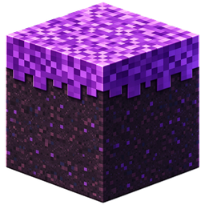

<div align="center">
  
  <h1>毛球</h1>
  <p><b>一个 Windows 上的 Minecraft Java 版启动器</b><br>
  <sub>Maoqiu is a Minecraft: Java Edition launcher for Windows.</sub></p>
</div>

> ⚠️ 毛球与 Mojang Studios、Microsoft **没有任何关系**，**未获得 Mojang 批准**，也不是官方产品。
> 本仓库**不包含任何 Minecraft 游戏文件**——游戏本体、素材、Mod 全部由你在本地下载。

---

## 它能做什么

**下载与安装**
- 原版游戏下载安装，官方源与国内镜像自动切换
- Mod 加载器一键安装：**Fabric / Forge / NeoForge / OptiFine**（在「下载」页点版本「安装」时选；
  已装的版本也能「加装 Mod 加载器」）
- 版本继承：在已有版本上加装 Mod，不用重下一遍

**Mod 生态**（对接 [Modrinth](https://modrinth.com)）
- 搜 Mod / 资源包 / 光影包 / 整合包 / 数据包，点下载自动放好位置
- 整合包「整套装」：缺的基础版本和加载器顺手一起装
- **拖进窗口就能装**：支持 Modrinth 的 `.mrpack`、常见启动器导出的普通 zip；
  **带密码的压缩包**也能装（自己实现的 ZipCrypto / AES 解密）
- 数据包装进指定存档的 `datapacks/`

**启动**
- 三种账号：离线名字 / 微软正版 / 外置登录（皮肤站）
- 内存、窗口大小、版本隔离等可按版本单独设置
- 一个启动器管多个游戏目录，版本列表跨目录汇总
- **Java 运行时管理**：自动列出本机 Java、可挑可加；缺的 Java 自动补下（可以关掉，关掉就一个字节都不下）

**联机**
- **VoxLink 房间码**：6 位房间码，借 VoxLink 的公共服务器牵线，打通之后直接进同一个世界
- **樱花内网穿透**：端口映射方式，**不需要管理员权限**

**其他**
- 五套主题、3D 皮肤小人（可拖拽 / 鼠标跟随）、皮肤库管理
- 存档与设置备份
- **AI 报错助手**：15 条本地规则（不联网、不花钱）+ 可接你自己的 AI（OpenAI 兼容格式，
  默认预置免费的智谱 GLM-4-Flash）。**你的 API Key 只存在你自己电脑上**，
  绝不打包进安装包，也不随请求发给第三方。

## 下载安装

到 [Releases](../../releases) 页下载安装包（最新 0.4.3）。

> GitHub 的下载文件名里**不能带中文**（会被吃掉），所以那儿的文件名是
> `maoqiu-<版本号>-setup.exe` —— 下载下来双击就行，跟你手上的
> `毛球-安装程序-<版本号>.exe` 是同一个东西。

**GitHub 直连慢的话，走网盘**——同一份安装包，国内快得多：

- **夸克网盘**：<https://pan.quark.cn/s/3ca8f71b6d67>
  —— 同一份安装包。网盘里**只放最新一版**（旧链接会失效），刚发新版时可能比 Releases 慢半步。

**或者走 GitHub 加速站**（不用网盘会员，点开直接下，2026-10-17 实测都能到 1 MB/s 以上）：

- <https://gh-proxy.com/https://github.com/3332098396/maoqiu-launcher/releases/download/v0.4.3/maoqiu-0.4.3-setup.exe>
  （实测最快，约 2.6 MB/s）
- <https://ghfast.top/https://github.com/3332098396/maoqiu-launcher/releases/download/v0.4.3/maoqiu-0.4.3-setup.exe>
  （约 2.5 MB/s）
- <https://ghproxy.net/https://github.com/3332098396/maoqiu-launcher/releases/download/v0.4.3/maoqiu-0.4.3-setup.exe>
  （约 1.2 MB/s）

> 这三家是**公开的免费加速站**，谁都可以用、也可能哪天就挂了——**一条不通就换下一条**。
> 换版本时把链接里的版本号（`v0.4.3`）改掉即可。

**装新版本不用先卸载**——直接双击新的安装包，它会就地覆盖旧版，设置、皮肤、存档都不动。

第一次打开会跳出「**Windows 已保护你的电脑**」——这是**没买数字签名的软件都会遇到的，不是中毒**，
点「**更多信息**」→「**仍要运行**」即可。安装时选「仅为我安装」，**不需要管理员权限**。

卸载只删程序本身：**存档、配置、游戏文件都原样保留**。

逐步说明见 [docs/07-安装与使用说明.md](docs/07-安装与使用说明.md)。

## 自己跑 / 重新打包

需要 Node.js。

```bash
npm install
npm start       # 开发模式运行
npm run dist    # 打包成 Windows 安装包，输出在 release/
npm run icons   # 重新生成图标
```

也可以直接双击项目根目录的 `启动毛球.bat`。

## 技术栈

Electron + 原生 HTML / CSS / JS。**没有构建步骤**，界面上不依赖任何第三方 JS 库。

主进程 / preload / 渲染层严格分离（`contextIsolation: true`、`nodeIntegration: false`），
渲染层不碰文件系统与命令行，一切系统能力都经 `window.api` 白名单暴露；
外部内容（版本名、Mod 名等）一律用 `textContent` 插入，不用 `innerHTML`。

## 项目结构

```
├── src/
│   ├── main/        主进程：下载、安装、启动、配置、联机
│   ├── preload/     安全桥：白名单式把能力暴露给界面
│   └── renderer/    界面：index.html / style.css / app.js
├── assets/          图标等静态资源
├── build/           打包用图标与安装脚本
├── scripts/         启动 / 打包 / 生成图标
├── docs/            需求、方案、规范、验收、隐私等文档
├── 开发日志/         每天一份开发记录
└── package.json
```

## 路线图

- [x] 微软正版登录：0.4.2 起客户端 ID 已内置，装上就能登录
- [ ] 联机：移植 [VoxLink](https://github.com/AUGUHDAR/VoxLink) 协议
      （房间码、打洞、房客直连房主已通；中继兜底与 Mod 同步还在做）
- [ ] 皮肤预览：评估换用 `skinview3d`

## 参与 / 反馈

遇到问题、有想法，欢迎开 [Issue](../../issues)。提 Bug 时请附上游戏日志
（`.minecraft/versions/<版本名>/logs/latest.log`）和你的网络环境。

## 致谢

联机部分的思路与协议参考自 [**VoxLink**](https://github.com/AUGUHDAR/VoxLink)（LGPL-3.0），
打洞组件感谢 [**Terracotta**](https://github.com/burningtnt/Terracotta)（AGPL-3.0），
内网穿透使用 [**frp**](https://github.com/fatedier/frp)（Apache-2.0），
外置登录使用 [**authlib-injector**](https://github.com/yushijinhun/authlib-injector)，
Mod 生态数据来自 [**Modrinth**](https://modrinth.com)。

完整致谢与许可说明见 [THIRD_PARTY_NOTICES.md](THIRD_PARTY_NOTICES.md)。

## 版权与署名

**毛球（Maoqiu）** © 2026 · 作者 **3332098396**（GitHub）·
项目地址 <https://github.com/3332098396/maoqiu-launcher>

按 [MIT 许可](LICENSE) 发布。**用、改、再发布、打包进你自己的项目、商用，都允许**——
但 MIT 有一条是硬要求，我们也把它当成底线：

> 源码里**每个文件的开头**都带着这两行（SPDX 许可标识 + 版权署名），照 [KAMUCL](https://github.com/kamubaba-i/KAMUCL)
> 的写法。**直接把文件复制走的时候，这两行别删**——那就是署名。
>
> **移植来的文件**（联机那批、离线皮肤）顶上还写明**原作者是谁**（VoxLink 的作者 AUGUHDAR、
> KAMUCL contributors），以及哪一部分是我们改的——**别人的功劳不会算到我们头上**，
> 我们的名字也不会被人撕掉。

- 🔴 **必须保留版权声明和作者署名。** 也就是 `LICENSE` 那份文件（连同上面的版权行）
  要**原样带着**，不许删掉、不许改成自己的名字，也不许把毛球说成是你写的。
- **改了之后再发布**：请在明显的地方写一句「**基于毛球（Maoqiu）修改**」并附上原项目链接。
- 反过来也一样——**我们用了别人的东西，署名一处不删**（见上一节和
  [THIRD_PARTY_NOTICES.md](THIRD_PARTY_NOTICES.md)）。

> ⚠️ **注意**：仓库里有**别人的组件**，它们的许可比 MIT 严，**署名和许可条款一个字都不能删**：
> 从 [VoxLink](https://github.com/AUGUHDAR/VoxLink) 移植的部分按 **LGPL-3.0-only**、
> 离线皮肤小代理按 **GPL-3.0-or-later**（源码随仓库提供）。
> 具体到哪个文件、什么许可，全部列在 [THIRD_PARTY_NOTICES.md](THIRD_PARTY_NOTICES.md)。
